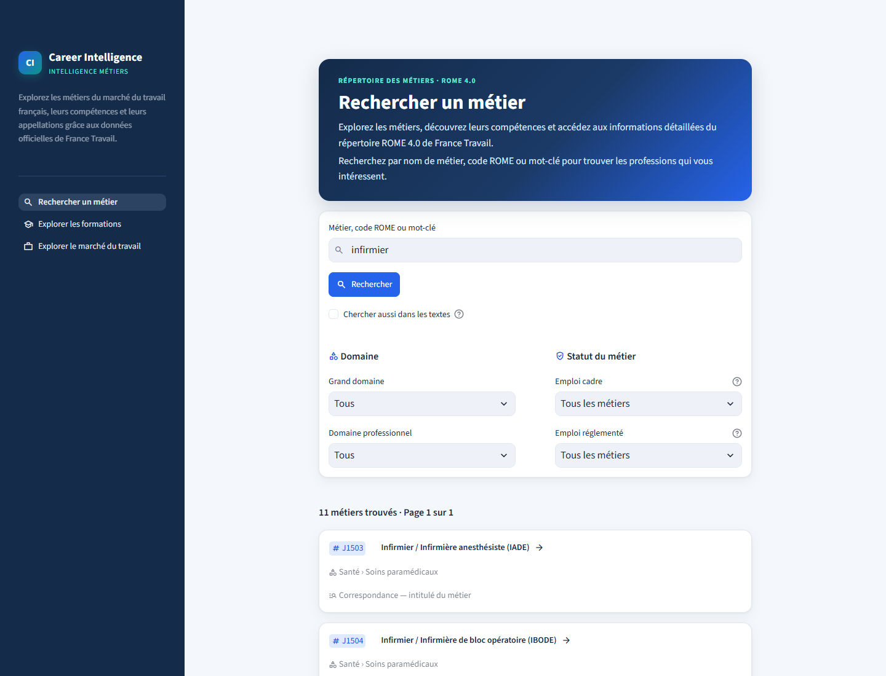
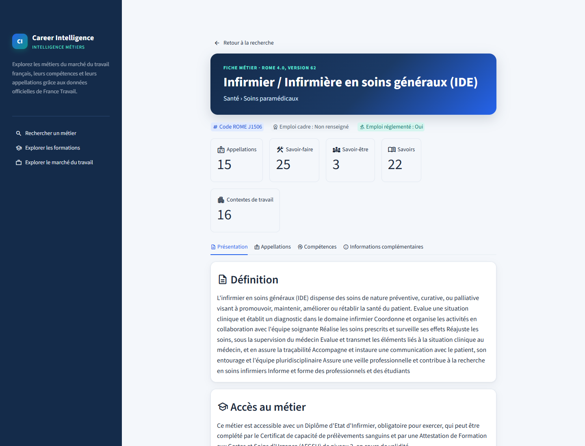
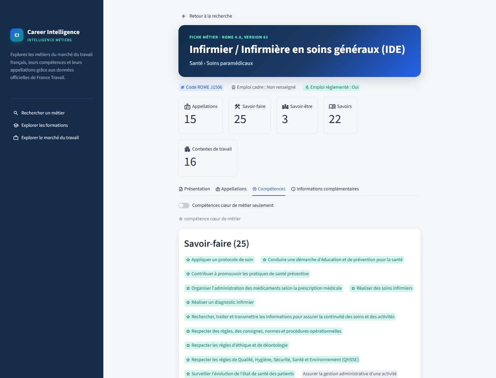
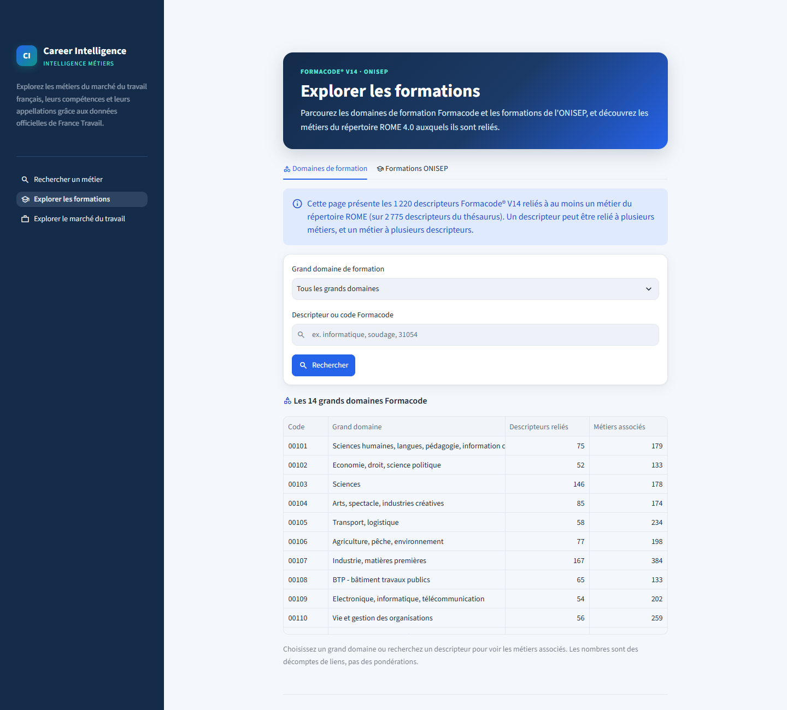
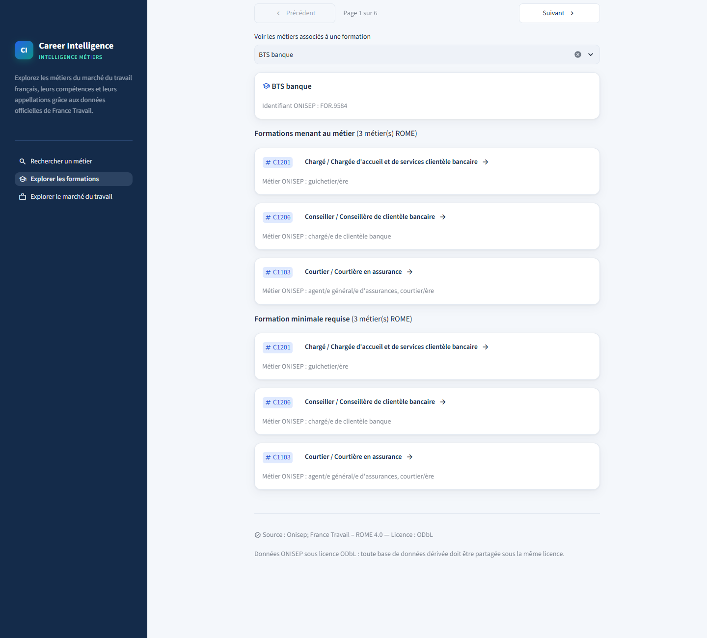
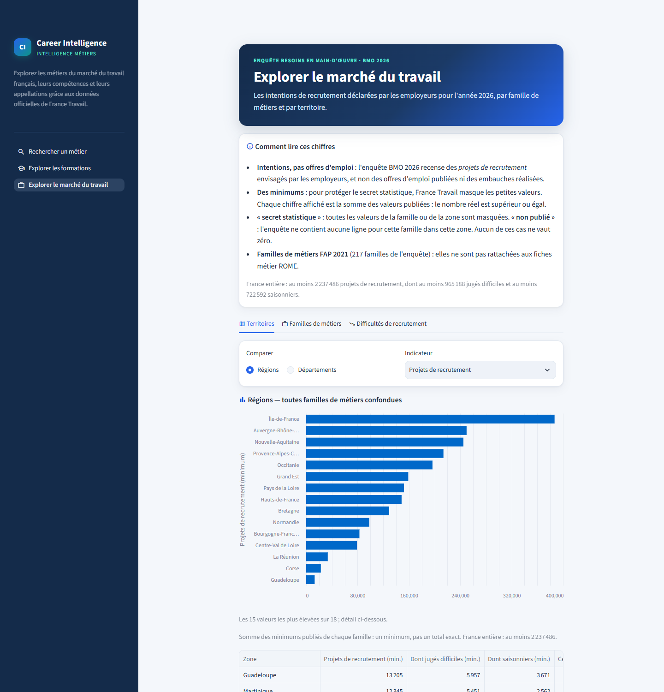
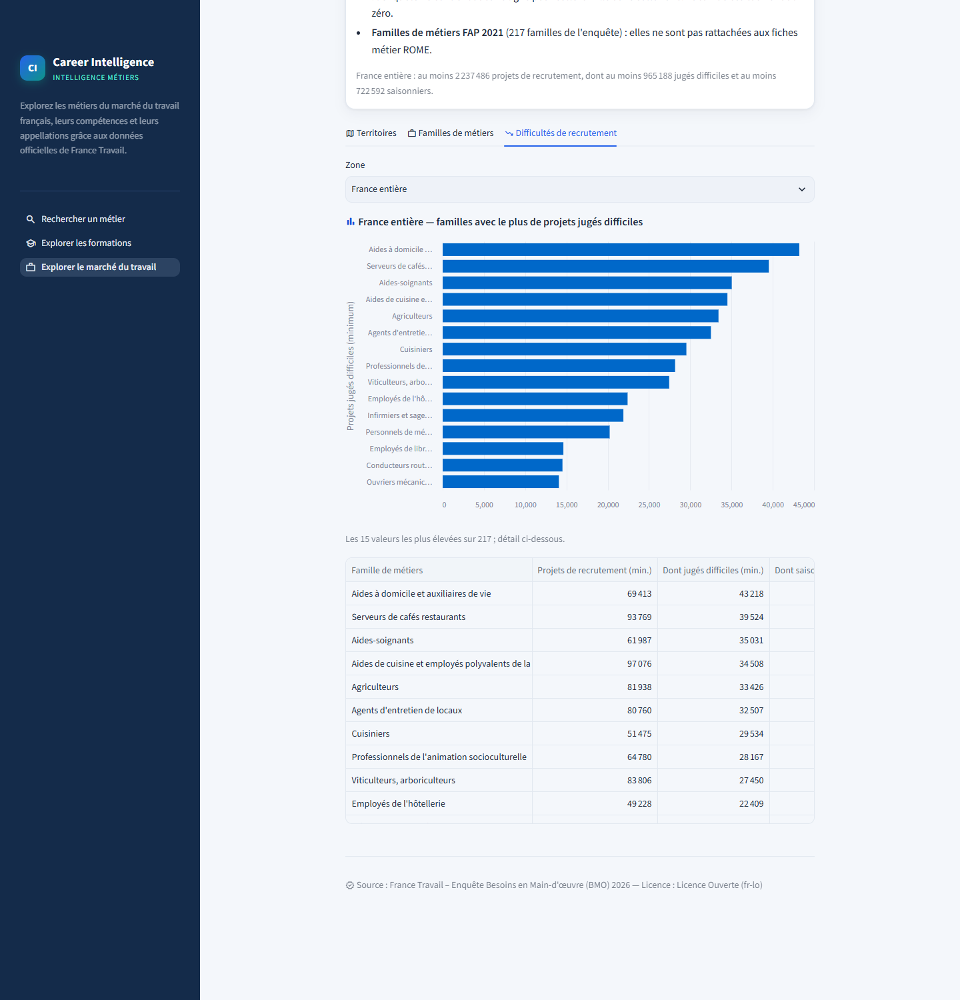

# Career Intelligence

**Multi-Source Data Integration & Search Platform** for professional orientation.

Career Intelligence integrates French open data on occupations, skills, training programmes and
recruitment intentions into a layered model on Databricks, and exposes it through a French-language
Streamlit application.

> **Status:** complete and validated as an academic portfolio project, run locally. Six official
> datasets are loaded from Bronze to Gold, exposed by a SQL search layer of 22 query contracts and
> used by four application pages. Final validation: 622 offline tests passed (2 skipped: the
> opt-in live suites), 55 live Databricks tests passed, and 325/325 SQL data-quality checks
> (`check_*`) are `true`.

## Features

The Streamlit application (French) has four pages:

| Page | Content | Sources |
|---|---|---|
| **Rechercher un métier** | Search occupations by name, ROME code or keyword, with domain, professional domain, *cadre* and regulated-occupation filters, pagination and a « Rechercher » button | ROME 4.0 v62 |
| **Fiche métier** | Occupation profile: definition, access, job titles, skills (savoir-faire, savoir-être, savoirs, work contexts), RIASEC and transition indicators | ROME 4.0 v62 |
| **Explorer les formations** | Formacode V14 training domains (14 grand domains, 1,220 descriptors linked to an occupation) and their occupations; ONISEP training programmes, their occupations and their partial coverage (392 / 1,923 occupations) | Formacode V14, ROME ↔ Formacode, ONISEP (ODbL) |
| **Explorer le marché du travail** | BMO 2026 recruitment intentions by FAP228 family and area: area comparisons, families, recruitment difficulties; values are minimums because of statistical secrecy | BMO 2026 |

BMO figures are never attached to ROME occupations, and the DARES correspondence (ROME **V3**) is
loaded into Gold but not shown in the application (its licence is unconfirmed).

## Screenshots

Captured from the application running locally on live Databricks data (interface in French).

<p align="center">
  
  <br><em>Rechercher un métier — search by name, ROME code or keyword, with domain and status filters.</em>
</p>

<table>
  <tr>
    <td width="50%" valign="top">
      
      <br><em>Fiche métier — profile of a ROME 4.0 occupation (J1506).</em>
    </td>
    <td width="50%" valign="top">
      
      <br><em>Fiche métier — skills, with core skills marked.</em>
    </td>
  </tr>
  <tr>
    <td width="50%" valign="top">
      
      <br><em>Explorer les formations — the 14 Formacode grand domains (1,220 descriptors linked to an occupation).</em>
    </td>
    <td width="50%" valign="top">
      
      <br><em>Explorer les formations — an ONISEP programme and its occupations (Source : Onisep, ODbL).</em>
    </td>
  </tr>
  <tr>
    <td width="50%" valign="top">
      
      <br><em>Explorer le marché du travail — BMO 2026 recruitment intentions by region (minimums).</em>
    </td>
    <td width="50%" valign="top">
      
      <br><em>Explorer le marché du travail — families with the most recruitment projects judged difficult (minimum counts).</em>
    </td>
  </tr>
</table>

All 12 screenshots, including filtered search, Formacode and ONISEP details, a family view and
the mobile layout, are in [`docs/images/`](docs/images/).

## Architecture

```
Official open-data files ─► Python connectors (download, validate, stage as Parquet)
   ─► Bronze ─► Silver ─► Gold ─► Search views + 22 SQL query contracts   (Databricks SQL, Delta)
   ─► SearchClient (read-only, validated parameters) ─► Streamlit application
```

- **Ingestion** (`src/career_intelligence/ingestion/`): local Python connectors download the
  verified files (or read manually downloaded ones), validate them and write Bronze-ready Parquet
  files with lineage columns, uploaded to a Unity Catalog volume.
- **Bronze → Silver → Gold → Search**: Databricks SQL scripts in `sql/`, each with a check file
  whose `check_*` columns must all be `true`. Transformations are written in **Databricks SQL**,
  not PySpark.
- **Search layer**: 4 views over Gold and 22 parameterized query contracts
  (`sql/search/queries/`), described by the registry `career_intelligence.search.contracts`.
- **Application**: `SearchClient` runs only the registered contract files, unchanged and
  read-only, on a SQL warehouse; the Streamlit pages contain no SQL.

See the full [project specification](docs/PROJECT_SPECIFICATION.md).

## Tech stack

Python 3.12 · pandas · Databricks Free Edition (Unity Catalog, Delta Lake, serverless SQL
warehouse) · Databricks SQL · databricks-sql-connector · Streamlit · pytest · Ruff

## Repository layout

```
career-intelligence/
├── app/                      # Streamlit application
│   ├── streamlit_app.py      # entry point and sidebar navigation
│   ├── common.py             # data access through SearchClient, shared components, styles
│   └── pages/                # rechercher_metier, fiche_metier, explorer_formations,
│                             # explorer_marche_travail
├── config/
│   ├── settings.example.yaml # non-secret settings template
│   └── sources.yaml          # verified data-source registry (URLs, checksums, licences)
├── data/                     # local working data (git-ignored)
├── docs/
│   ├── PROJECT_SPECIFICATION.md
│   └── DATA_SOURCES.md       # source verification log, Gold and Search documentation
├── sql/                      # Databricks SQL: 00_setup, bronze, silver, gold, search
│   └── search/queries/       # q01…q22 parameterized query contracts
├── src/career_intelligence/  # Python package
│   ├── config.py             # settings & secrets loading
│   ├── ingestion/            # source connectors (Bronze-ready Parquet)
│   ├── search/               # contracts registry, Databricks connection, SearchClient
│   └── utils/                # logging
├── tests/                    # pytest suite (tests/live: opt-in Databricks tests)
├── .env.example              # environment-variable template
├── pyproject.toml
├── requirements.txt
└── requirements-dev.txt
```

`notebooks/`, `scripts/` and `src/career_intelligence/transformation/` are empty placeholders
from the initial structure: every transformation is a SQL script in `sql/`.

## Getting started (Windows / PowerShell)

```powershell
# 1. Create and activate the virtual environment (Python 3.12)
py -3.12 -m venv .venv
.\.venv\Scripts\Activate.ps1

# 2. Install dependencies (runtime + dev tools) and the package in editable mode
python -m pip install -r requirements-dev.txt
python -m pip install -e . --no-deps

# 3. Create local configuration from the templates (both files are git-ignored)
Copy-Item .env.example .env
Copy-Item config\settings.example.yaml config\settings.yaml

# 4. Run checks
python -m pytest
python -m ruff check .
```

> If script execution is blocked, run once:
> `Set-ExecutionPolicy -Scope CurrentUser RemoteSigned`

Live tests of the search contracts (`tests/live`) are skipped unless configured. To run them,
install the optional Databricks client and set the connection in the session only:

```powershell
python -m pip install -e ".[databricks]"
$env:CAREER_INTELLIGENCE_LIVE = "1"
$env:DATABRICKS_SERVER_HOSTNAME = "<your-workspace>.cloud.databricks.com"
$env:DATABRICKS_HTTP_PATH = "/sql/1.0/warehouses/<warehouse-id>"
$env:DATABRICKS_CONFIG_PROFILE = "career-intelligence"   # token from `databricks auth token`
python -m pytest tests/live
```

## Ingestion

| Dataset | Command | Output (git-ignored) |
|---|---|---|
| France Travail BMO | `python -m career_intelligence.ingestion.bmo [--year 2026] [--force]` | `data/raw/france_travail/bmo/<year>/bmo_<year>.xlsx` (raw, immutable)<br>`data/staging/france_travail/bmo/bmo_<year>.parquet` + `.manifest.json` |
| ONISEP (Fiches métiers, Fiches formations, Formations initiales) | `python -m career_intelligence.ingestion.onisep [--force]` | `data/raw/onisep/<YYYYMMDD>/` (3 files, kept per snapshot)<br>`data/staging/onisep/<YYYYMMDD>/<dataset>.parquet` + `onisep_<YYYYMMDD>.manifest.json` |
| DARES ROME × qualification → FAP 2021 (manual download) | `python -m career_intelligence.ingestion.dares` (`--readme`: qualification classes from the XLSX `Lisez-moi` sheet) | reads `data/raw/dares/fap2021/<YYYYMMDD>/` (files downloaded in a browser, sha256-pinned in `config/sources.yaml`)<br>`data/staging/dares/fap2021/<YYYYMMDD>/rome_qualif_fap2021[_lisez_moi].parquet` + `.manifest.json` |
| DARES FAP 2021 nomenclature (22 / 86 / 228 / 341) | `python -m career_intelligence.ingestion.fap2021 [--force]` | `data/raw/dares/fap2021_nomenclature/<snapshot>/` (sha256-pinned)<br>`data/staging/dares/fap2021_nomenclature/<snapshot>/dares_fap2021_nomenclature.parquet` + manifest |
| ROME ↔ Formacode V14 + Formacode V14 thesaurus | `python -m career_intelligence.ingestion.formacode [--force]` | `data/raw/formacode/<snapshot>/` (4 files, sha256-pinned)<br>`data/staging/formacode/<snapshot>/<table>.parquet` (3 tables) + manifest |
| France Travail ROME 4.0 | `python -m career_intelligence.ingestion.rome [--force]` | `data/raw/france_travail/rome/v<version>/rome_open_data_csv.zip` (kept per release)<br>`data/staging/france_travail/rome/v<version>/<entity>.parquet` (one per CSV) + `rome_v<version>.manifest.json` |

Each run downloads the file only if it is missing (`--force` to refresh), reads every value as text,
standardises column names, validates (structure, formats, keys, consistency), and writes a
Bronze-ready Parquet file with lineage columns (`_source_*`, `_run_id`, `_ingested_at`) plus a JSON
manifest (checksum, validation report, column profile). Download URLs come only from verified
entries in `config/sources.yaml`.

## Databricks (Free Edition)

Authentication uses the Databricks CLI with OAuth (no token in the repository):

```powershell
databricks auth login --host https://<your-workspace>.cloud.databricks.com --profile career-intelligence
```

| Object | Name |
|---|---|
| Catalog | `career_intelligence` |
| Schemas | `career_intelligence.bronze`, `career_intelligence.silver`, `career_intelligence.gold`, `career_intelligence.search` |
| Volume | `career_intelligence.bronze.landing` → `/Volumes/career_intelligence/bronze/landing/` |
| Tables | `bronze.bmo_2026` (raw text) → `silver.bmo_2026` (typed, cleaned)<br>`bronze.rome_<entity>` — 29 raw ROME 4.0 tables, one per source CSV<br>`silver.rome_*` — 24 clean ROME tables: 13 reference entities + 11 occupation links<br>`bronze.onisep_fiches_metiers`, `bronze.onisep_fiches_formations`, `bronze.onisep_formations_initiales` — raw ONISEP (ODbL)<br>`silver.onisep_*` — 8 ONISEP tables: occupations, training sheets, training catalogue + 5 relationships (incl. occupation → ROME)<br>`bronze.dares_rome_qualif_fap2021` — DARES ROME V3 × qualification → FAP341 (raw; qualification-dependent)<br>`bronze.dares_fap2021_nomenclature`, `bronze.dares_rome_qualif_fap2021_lisez_moi` → `silver.fap2021`, `silver.dares_qualification`, `silver.dares_rome_v3_fap341` — FAP 2021 hierarchy, qualification classes 0–9, ROME **V3** × qualification → FAP341 (not joined to ROME v62)<br>`bronze.rome_formacode_v14`, `bronze.formacode_v14_descripteurs`, `bronze.formacode_v14_grands_domaines` — ROME v62 ↔ Formacode V14 + official thesaurus<br>`silver.formacode`, `silver.formacode_grand_domaine`, `silver.formacode_terme_associe`, `silver.rome_metier_formacode` — Formacode thesaurus (official labels, hierarchy) + occupation → training-domain links<br>`gold.metier`, `gold.bmo_recrutement`, `gold.source_licence` + views `gold.v_metier_appellation`, `v_metier_competence`, `v_metier_domaine_formation`, `v_metier_formation_onisep` (ODbL), `v_fap`, `v_rome_v3_fap` — integrated model; BMO figures are minimums by FAP228 × geography, never linked to ROME v62 (see `docs/DATA_SOURCES.md` §6) |

Load steps (run SQL on the SQL warehouse, e.g. from the SQL editor):

1. `sql/00_setup/01_catalog_schema_volume.sql` — catalog, schema, volume (idempotent)
2. Upload the staged file:
   `databricks fs cp data\staging\france_travail\bmo\bmo_2026.parquet dbfs:/Volumes/career_intelligence/bronze/landing/france_travail/bmo/2026/bmo_2026.parquet --profile career-intelligence`
3. `sql/bronze/01_bmo_2026.sql` — create the Bronze Delta table
4. `sql/bronze/01_bmo_2026_checks.sql` — verification queries with expected values
5. `sql/silver/01_bmo_2026.sql` — Silver table: measures as `INT` (`NULL` + `*_secret` flag for statistical secrecy), label whitespace normalised (incl. non-breaking spaces)
6. `sql/silver/01_bmo_2026_checks.sql` — every `check_*` column must be `true`
7. ROME: upload the raw zip and the staging folder (commands in the header of `sql/bronze/02_rome.sql`), then run `sql/bronze/02_rome.sql` (29 tables) and `sql/bronze/02_rome_checks.sql`
8. `sql/silver/02_rome.sql` (24 tables) and `sql/silver/02_rome_checks.sql` — every `check_*` must be `true`
9. ONISEP: upload raw + staging folders (commands in the header of `sql/bronze/03_onisep.sql`), then run `sql/bronze/03_onisep.sql` and `sql/bronze/03_onisep_checks.sql`
10. `sql/silver/03_onisep.sql` (8 tables; needs `silver.rome_metier`) and `sql/silver/03_onisep_checks.sql` — every `check_*` must be `true`
11. DARES: download the two files manually (site behind a captcha) into `data/raw/dares/fap2021/<YYYYMMDD>/`, run the connector, upload (commands in the header of `sql/bronze/04_dares.sql`), then `sql/bronze/04_dares.sql` and `sql/bronze/04_dares_checks.sql`
12. Formacode: run the connector, upload (commands in the header of `sql/bronze/05_formacode.sql`), then `sql/bronze/05_formacode.sql` and `sql/bronze/05_formacode_checks.sql` (needs `silver.rome_metier`)
13. `sql/silver/04_formacode.sql` (4 tables) and `sql/silver/04_formacode_checks.sql` — every `check_*` must be `true`
14. DARES FAP hierarchy + qualification readme: run both connectors, upload (commands in the header of `sql/bronze/06_dares_fap2021.sql`), then `sql/bronze/06_dares_fap2021.sql` and `sql/bronze/06_dares_fap2021_checks.sql`
15. `sql/silver/05_dares.sql` (3 tables: `fap2021`, `dares_qualification`, `dares_rome_v3_fap341`) and `sql/silver/05_dares_checks.sql`
16. `sql/gold/01_gold.sql` (schema `gold`: 3 tables + 6 views, built from Silver only) and `sql/gold/01_gold_checks.sql` — every `check_*` must be `true`
17. `sql/search/01_search.sql` (schema `search`: 4 views over Gold) and `sql/search/01_search_checks.sql` — every `check_*` must be `true`

Every step is a Databricks SQL script run on the SQL warehouse; no PySpark code or local Spark is
needed (the optional `[spark]` extra in `pyproject.toml` is unused).

## Search layer

The application queries the warehouse only through 22 parameterized SQL contracts
(`sql/search/queries/q01…q22_*.sql`, named parameters `:name`). The registry
`career_intelligence.search.contracts` documents each one (parameters, output columns, key,
sources, licence) and `bind()` validates the inputs:

```python
from career_intelligence.search.contracts import bind

query = bind("rechercher_metiers", q="électricien", page=1, page_size=20)
cursor.execute(query.sql, parameters=query.parameters)  # databricks-sql-connector
# or: {"statement": query.sql, "parameters": query.statement_parameters()}  (Statement Execution API)
```

| Search need | Contracts |
|---|---|
| Occupations by name, ROME code or keyword | `rechercher_metiers`, `fiche_metier`, `appellations_metier` |
| Descriptions and professional domains | `fiche_metier`, `lister_domaines` |
| Skills, knowledge, work contexts | `rechercher_competences`, `competences_metier`, `metiers_par_competence` |
| Formacode training domains | `domaines_formation_metier`, `rechercher_domaines_formation`, `metiers_par_domaine_formation`, `lister_grands_domaines_formation`, `parcourir_domaines_formation` |
| ONISEP programmes (ODbL — display "Source : Onisep") | `rechercher_formations_onisep`, `formations_onisep_metier`, `metiers_par_formation_onisep`, `couverture_onisep` |
| BMO recruitment by FAP and area (minimums) | `rechercher_fap`, `recrutement_bmo`, `lister_zones_geo`, `synthese_zones_bmo` |
| DARES ROME **V3** × qualification → FAP | `rechercher_rome_v3` |
| Licences and attributions | `licences` |

Matching is case- and accent-insensitive, every word is required, and results are ranked only by
match tier (`rang_pertinence`). BMO figures are never linked to ROME occupations. Details:
`docs/DATA_SOURCES.md` §7.

## Lancer l'application

The Streamlit application (French) has four pages — « Rechercher un métier », « Fiche métier »,
« Explorer les formations » and « Explorer le marché du travail » (see [Features](#features)). It
queries Databricks only through the search contracts; credentials stay on the server.

1. Install the Databricks client: `python -m pip install -e ".[databricks]"`
2. Log in once with the CLI (the token is obtained in memory, never stored by the app):
   `databricks auth login --host https://<your-workspace>.cloud.databricks.com --profile career-intelligence`
3. In `.env` (git-ignored), set `DATABRICKS_CONFIG_PROFILE`, `DATABRICKS_SERVER_HOSTNAME`
   (workspace host without `https://`) and `DATABRICKS_WAREHOUSE_ID` (see `.env.example`).
4. From the project root: `streamlit run app/streamlit_app.py --server.address localhost`
   (opens http://localhost:8501). Keep `--server.address localhost`: without it Streamlit also
   listens on the network, and every query runs with your Databricks login.

## Configuration & secrets

- Non-secret settings: `config/settings.yaml` (copied from the example).
- Secrets: none are stored. The application and the live tests authenticate with the Databricks
  CLI OAuth login (short-lived token kept in memory); `.env` holds only the workspace host,
  SQL warehouse id and CLI profile name.
- `.env`, `config/settings.yaml`, `.databrickscfg` and `.streamlit/secrets.toml` are git-ignored.
  **Never commit credentials.**

## Data sources

Six datasets are loaded, all from official publishers: ROME 4.0 v62 (France Travail), BMO 2026
(France Travail), ROME ↔ Formacode V14 correspondence (France Travail) and Formacode V14 thesaurus
(Centre Inffo), ONISEP Idéo open data, and DARES FAP 2021 (nomenclature and ROME V3 × qualification
correspondence). Each was verified (documentation, licence, test download, checksum) before its
connector was written; the francetravail.io APIs were not used. Details:
[docs/DATA_SOURCES.md](docs/DATA_SOURCES.md).

## Roadmap

0. ✅ Repository initialisation
1. ✅ Data-source verification
2. ✅ Databricks workspace setup (catalog, schemas, volume)
3. ✅ Bronze connectors and tables
4. ✅ Silver transformations & quality checks
5. ✅ Gold integrated model & SQL views
6. ✅ Search layer & Streamlit application (four pages)
7. ✅ Final integration, validation & documentation

Not implemented by decision: DARES qualification page (licence unconfirmed), public deployment
(Databricks Free Edition terms), BMO figures per ROME occupation. See
[docs/PROJECT_SPECIFICATION.md](docs/PROJECT_SPECIFICATION.md) §6.

## License

Proprietary — All Rights Reserved (academic portfolio project). No licence is granted to copy,
modify or redistribute the code. Each external data source remains subject to its own licence and
terms of use.

### Data attribution

| Source | Licence | Obligation |
|---|---|---|
| France Travail — ROME 4.0, BMO, ROME ↔ Formacode correspondence | Licence Ouverte (Etalab) | Attribution to France Travail |
| Centre Inffo — Formacode® V14 thesaurus | Licence Ouverte 2.0 | Attribute "Formacode® V14 – Centre Inffo" (Formacode® is a registered trademark) |
| DARES — FAP 2021 nomenclature and ROME × qualification → FAP correspondence | **Unconfirmed** (no statement in the files; not assumed to be Licence Ouverte) | Attribute "Source : Dares, nomenclature des familles professionnelles FAP-2021"; confirm reuse conditions before any public release |
| **ONISEP — Idéo open data** | **Open Database License (ODbL)** | Display **"Source : Onisep"**; any publicly used database derived from ONISEP data must be shared under **ODbL** (share-alike) |

All ONISEP-derived tables (Bronze and Silver) and the Gold view `v_metier_formation_onisep` carry the table properties
`source.license = ODbL` and `source.attribution = Source : Onisep`. The Streamlit application
must display "Source : Onisep" wherever ONISEP-derived data is shown.
